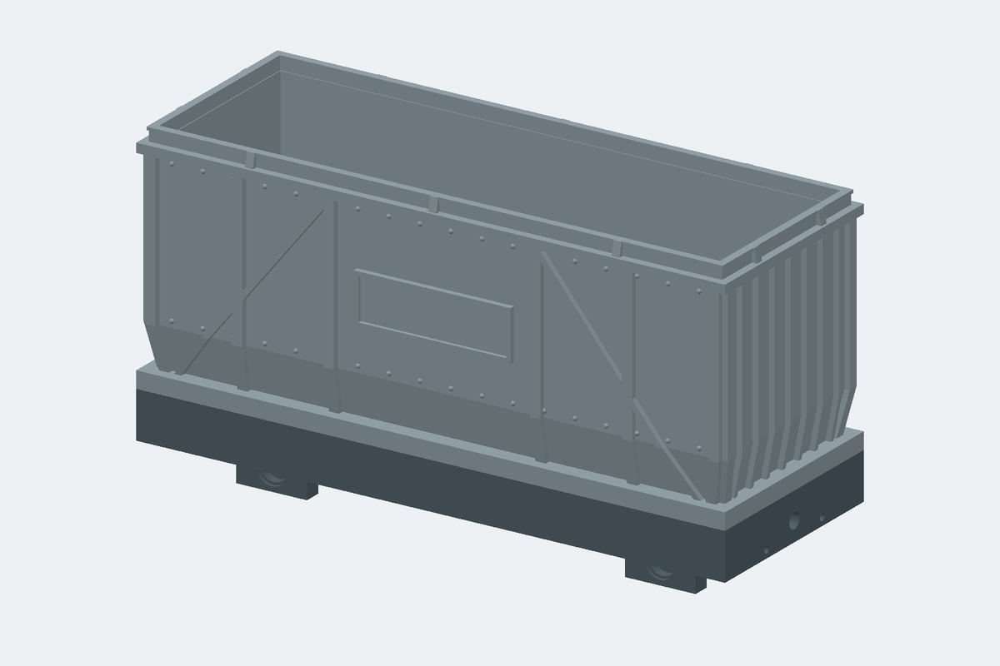
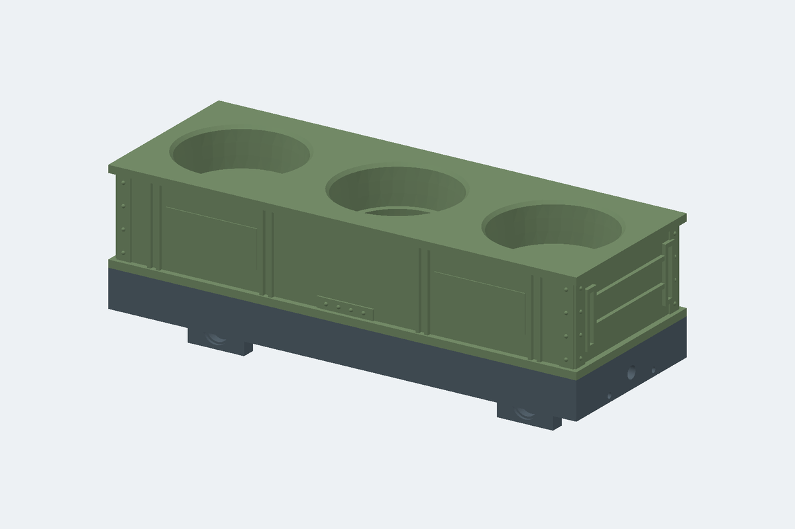

# Gauge 0 Wagon Base (parametric)

3D-printable modular wagon chassis for Spur 0 (32 mm gauge). Generated by
`wagon_base.py` (run `freecadcmd wagon_base.py`), but **you normally don't need
the script**: open `WagonBase.FCStd` in FreeCAD and edit the `Params`
spreadsheet — the whole model recomputes. The script only regenerates the file
from scratch (e.g. after topology changes).
A build takes ~35–45 s (most of it the decorated ModuleCoal2); `WAGON_FULL_CHECK=1 freecadcmd wagon_base.py` adds the
slow checks (every vent slot, resize/restore cycle, ~4 min).

Files: `WagonBase.FCStd` (parametric model, includes a blank module plate and
all modules: ModuleCoal, ModuleCoal2, ModuleCoal3 + lid, ModuleShot, ModuleShot2), `WagonBase.step`, `WagonBase.stl`, `ModulePlateBlank.stl`,
`ModuleCoal.stl`, `ModuleCoalDecorated.stl`, `ModuleCoalLid.stl` (lid + coal),
`ModuleShot.stl`, `ModuleCoal2.stl`, `ModuleCoal2Lid.stl` (lid + coal).

The coupler/power connector holder is a separate part: `connector_holder.py`
→ `ConnectorHolder.FCStd`, `HolderMale.stl`, `HolderFemale.stl`,
`FitCoupon.stl` (see "Magnetic connector" below).

Coordinates: origin at wagon center, Z = 0 is the platform top.

## Bearings / axles

Designed for **F683ZZ** flanged ball bearings (spec sheet:
`flanschkugellager.jpg`): bore 3 mm (axle), OD 7 mm, width 3 mm, flange
Ø8.1 × 0.8 mm.

- Bearings press in from the **outer** pedestal faces; the flange sits in a
  recess and ends up flush with the face (pocket Ø7.15, flange recess Ø8.4).
  Printed horizontal holes shrink slightly — ream with a 7 mm drill if the fit
  is too tight, or raise `presspassung`.
- `lagerbock_abstand` (default 27 mm) is the distance over the two bearing flanges =
  the space your wheelset needs between the wheel back faces. **Adjust it to
  your metal wheelsets** (Spur 0 back-to-back is ~29 mm; leave ~1 mm total
  clearance, and use spacer washers on the axle so the wheel hub doesn't rub
  the bearing flange).
- Axle continues through a Ø3.8 clearance bore; nothing else touches it.

## Module interface (for all future modules)

A module is anything with a flat base plate that lies **on top** of the frame
(no recessed seat — nothing has to fit into a printed pocket):

- Plate footprint: `laenge × breite` (same as the frame, **150 × 55 mm** at
  default size), thickness `modulplatte_dicke` = **2 mm**. A smaller plate works too as
  long as it covers the screw positions it uses.
- The frame top is one flat plane at z = 0: a `randbreite` = 4 mm rim all around,
  the two axle-bridge tops and the four corner bosses. The plate rests on
  all of them.
- Fixing: 10 × M2 self-tapping screws from the top (Ø1.8 pilot holes in the
  base, Ø2.2 through holes in the plate):
  - 4 on the axle bridges at `(±radstand/2, ±6)`
  - 2 in the middle of the sides at `(mitte_x, ±(breite/2 − 5.5))`, on two
    screw blocks on the side walls (`mitte_x` = 0)
  - 4 in the corners at `(±(laenge/2 − 5.5), ±(breite/2 − 5.5))`
- Keep-out for anything reaching down through the top opening: the axle
  bridges (10 mm wide at `±radstand/2`, down to z = −9) and the wheel
  wells. Elsewhere it is open to z = −12.
- `ModulePlateBlank` in the same document is the template — model cargo
  (cartridge, coal, 3-shot holder, …) on top of a copy of it. Wires can pass
  the plate anywhere over the open bay.

## ModuleCoal3 — open framed wagon body

**`ModuleCoal3` is inside `WagonBase.FCStd`**, with its controls appended to
the existing **`Params`** sheet under **Kohlemodul 3** (aliases `coal3_*`).
Drawn from `coal_wagon_sketch.jpeg`: tapered lower panels, four intermediate
posts per long side, diagonal braces in the outer panels, seven fins on each
end, rivets, top/bottom bands and a raised open rim with clamp straps. In
place of the nameplate, the centre panel of each long side has **close
horizontal vent slots**: 6 rows × 3 columns of 12 × 1 mm slots, 1.2 mm bars.
Like the ModuleCoal vents, every slot climbs `coal3_schlitz_anstieg` = 1.5 mm
from outside to inside, so water that gets in runs back out; the short slots
keep each printed bridge short. The open top is closed by the drop-in
**`ModuleCoal3Lid`** with the coal load (below).

- Edit the `coal3_*` rows in **`Params`**. All geometry is native,
  expression-driven FreeCAD features; no script is needed after edits. The
  mounting dimensions are the base's own `laenge`, `breite`, `radstand`,
  `modulplatte_dicke` and `modul_bohrung_d`, so the body follows frame
  changes live.
- Print **`ModuleCoal3.stl`**, floor down, open top up. The default part is
  **150 × 55 × 60.5 mm**, including the 2 mm floor and 3.5 mm raised rim.
  Use a 0.4 mm nozzle, 0.16–0.20 mm layers and at least 3 perimeters. The
  lower wall taper is gentle; the largest outward step is the 2 mm top-band
  overhang. Check that step in the slicer for your printer's support settings.
- **Lid** (`ModuleCoal3Lid` + `Coal3Load` → `ModuleCoal3Lid.stl`): a
  1.2 mm plate that drops into the body and rests on a 1.5 mm, 45°-chamfered
  ledge inside the walls (prints without supports). It carries the existing
  `CoalLoad` pile (scaled once by 1–4 % to fit the opening), and its height
  is set so the **highest coal lump is exactly level with the rim top**: the
  lid adds 0 mm to the wagon height. `coal3_kohle_ueber` moves the coal up or
  down (e.g. 1 = 1 mm proud); the lid sits at z ≈ 49.4 by default. Print the
  lid **plate down, coal up**, no supports; the STL holds two overlapping
  shells (plate + coal), which slicers merge. 0.25 mm gap per side
  (`coal3_deckel_spiel`). Lift it out by the coal.
- Mount directly on the chassis at Z=0 using **four M2 screws from inside**,
  through Ø2.2 holes at **(±radstand/2, ±6) mm** into the existing axle-bridge
  pilots. The module includes its own mounting floor; do not stack it on a
  separate blank plate. The six corner/middle base bosses are unused so the
  tapered lower walls can stay continuous. A Ø4.8 screw-head/driver envelope
  is checked above every hole.

Key editable parameters (mm except `coal3_knick_anteil`):

| Params alias | Default | Meaning |
|---|---:|---|
| `coal3_hoehe` | 55 | Body height above the floor, excluding the raised rim |
| `coal3_wand` | 1.8 | Wall thickness measured horizontally |
| `coal3_einzug` | 2 | Upper wall setback from the mounting plate edge |
| `coal3_verjuengung` | 2.5 | Additional inward taper per side at the bottom |
| `coal3_knick_anteil` | 0.24 | Fraction of body height occupied by the taper |
| `coal3_traeger_breite` / `coal3_relief` | 2.6 / 1.4 | Post width / outward projection |
| `coal3_strebe_breite` | 1.8 | Diagonal brace width measured along the wagon |
| `coal3_gurt_hoehe` | 2.4 | Top/bottom band height |
| `coal3_rand_hoehe` / `coal3_rand_wand` | 3.5 / 1.6 | Raised rim height / thickness |
| `coal3_rippe_breite` | 1.2 | End-fin thickness |
| `coal3_niet_d` | 1.2 | Rivet diameter |
| `coal3_schlitz_hoehe` / `coal3_schlitz_abstand` | 1 / 2.2 | Vent slot height / row spacing (bar = spacing − height, ≥ 1 mm) |
| `coal3_schlitz_laenge` / `coal3_schlitz_steg` | 12 / 1.5 | Slot length / bar between the slot columns |
| `coal3_schlitz_anstieg` | 1.5 | Slot is this much higher inside than outside |
| `coal3_deckel_dicke` / `coal3_deckel_spiel` | 1.2 / 0.25 | Lid plate thickness / gap per side |
| `coal3_auflage` | 1.5 | Width of the inner ledge the lid rests on |
| `coal3_kohle_ueber` | 0 | Highest coal lump above the rim top (0 = flush) |

The vent field is centred automatically between the wall knee and the lid
ledge. `coal3_kohle_hoehe` is the measured coal height above the plate —
don't edit it. The coal is a mesh: its height follows the spreadsheet, but
its footprint is fixed when the script runs, so after changing `laenge`,
`breite`, `coal3_einzug` or `coal3_wand` re-run the installer (or check the
coal still fits the lid).

The clear upper opening is **142.4 × 47.4 mm** at the defaults
(`coal3_innen_laenge` × `coal3_innen_breite`); the raised rim opening is
0.4 mm larger in each direction. Allow printing clearance when designing a
future insert. Keep `coal3_relief < coal3_einzug`, `coal3_rand_wand <=
coal3_wand`, and the vent field between the inner posts and clear of the
rivet rows and lid ledge (checked by the script). Tested body heights:
40–75 mm (below ~40 the six slot rows no longer fit under the lid); wall
thicknesses: 1.8 and 2.4 mm. Extreme parameter combinations
can cause intersections; check the resulting solid before exporting. After
edits, select **only `ModuleCoal3`** and export STL/STEP again (for the lid:
`ModuleCoal3Lid` + `Coal3Load` together as one STL); exports are not
live-linked.

`module_coal3.py` adds the module to an existing saved `WagonBase.FCStd`,
preserving its previous parameter values and geometry (like
`module_shot2.py`). It refuses to replace an already installed
`ModuleCoal3`; edit that model through Params instead. If regenerating the
whole base with `wagon_base.py`, run `freecadcmd module_coal3.py` afterwards
to add this module again (it needs `CoalLoad`). Fin, rivet and vent slot
counts are constants at the top of the script. `COAL3_FULL_CHECK=1 freecadcmd module_coal3.py` also checks
short/tall bodies, thicker walls, a raised coal/thicker lid and changed
frame dimensions, then restores
defaults. Checks cover valid connected solids, mounting/driver access,
chassis interference, the open load cavity, open vent slots, lid fit
(passes the rim, rests on the ledge, no collision, coal inside the plate
and level with the rim), footprint, preservation of the
existing base/modules and a closed single-component export mesh.

## Coal wagon module (Kohlemodul)

`ModuleCoal`, `ModuleCoalDecorated`, `ModuleCoalLid` and `CoalLoad` in
`WagonBase.FCStd`. The module carries the train electronics and is closed
against rain from above.

- **Tub** (`ModuleCoal.stl`): the module plate is its floor, so it screws onto
  the frame from above through the same 10 holes. Walls 1.8 mm, `wanne_hoehe`
  = 60 mm. Inner space ≈ 143 × 48 × 60 mm (minus the two small pin brackets
  under the rim of the end walls). Keep the 8 screw heads free; a 14 × 6 mm cable hole in the
  floor centre leads into the frame. Print floor down, no supports.
- **Vent slots**: thin *horizontal* slots (10 × 1.2 mm) in all four walls, in
  a low group (fresh air in) and a high group (warm air out), 3 rows each.
  Every slot climbs `schlitz_anstieg` = 1.5 mm from the outer to the inner
  opening, so water that gets in runs back out. Slot count is fixed when the
  script runs; size and spacing follow the spreadsheet.
- **Decorated** (`ModuleCoalDecorated.stl`): the same tub dressed as a steel
  body. All beams have one size (`deko_traeger` = 2.5 mm, 0.8 mm proud):
  bottom and top band, two belts between the slot groups, and the four
  corner posts.
- **Lid with coal** (`ModuleCoalLid.stl`): printed separately, **coal up,
  flat underside on the bed** — no supports. A slab the size of the plate
  that lies on the tub walls and overhangs them by 1.5 mm, with a 4 mm rim
  (`kappe_hoehe`) around the coal. The rim is a U-channel (flanges + groove). Rain runs
  off the overhang; a drip groove under the overhang (outside the walls)
  stops water creeping inward. Two pins on sloped brackets under the end
  walls (`stift_d`, `stift_h`) drop into holes in the lid underside, so it
  can't slide off; it fits either way round. The STL contains two
  overlapping shells (lid + coal); slicers merge them.
- **Coal generator** (`make_coal` in `wagon_base.py`): ~2000 random convex
  lumps (intersections of random planes, flattened, 1.2–4.5 mm) are scattered
  over a heap shape (`kohle_rand`, `kohle_haufen`), each sunk a random amount;
  the topmost surface is kept on a `kohle_raster` = 0.3 mm grid. Gives angular,
  faceted chunks with deep gaps and no overhangs. Change `kohle_seed` for a
  different pile. **The coal is a mesh**: its height follows the spreadsheet
  (`wanne_hoehe`, `modulplatte_dicke`), but its shape and footprint (heap,
  lump size, seed, length, width, rim height) only change when
  `wagon_base.py` runs.

## Coal module 2 (Kohlemodul 2, after `coal_wagon_sketch.jpeg`)

Same tub size, floor, screw holes, lid pins and lid fit as `ModuleCoal`, but
no vent slots, and styled after the sketch:

- hopper walls: the lower part (up to `k2_knick` = 35 % of the height) leans
  in, the upper part is vertical
- bottom, knee and top bands; corner posts; 4 side posts per side
  (`k2_feld_innen` / `k2_feld_aussen`); X-braces in the end panels, one brace
  in each middle panel
- nameplate between the inner posts with raised lettering
  (`k2_schild_text1` / `k2_schild_text2`, DejaVu Sans Condensed Bold, power
  symbol in front of line 2; the text is only rebuilt when the script runs)
- cooling fins on both ends (`k2_rippen`), Ø3.1 holes for 3 mm LEDs at the
  top corners of both ends (`led_d`)
- `ModuleCoal2Lid`: the coal lid with clamp straps across the rim channel

All relief stays inside the frame footprint (posts and bands reach 1.3 mm out
of the 1.5 mm `wanne_einzug`), so it is shallow. No rivets: hundreds of them
made the build take minutes. This is the module shown when the file opens.

## ModuleShot2 — styled three-glass wagon

**`ModuleShot2` is inside `WagonBase.FCStd`**, with its controls appended to
the existing **`Params`** sheet under **Shotmodul 2**. It follows
`shot_wagon_sketch.jpeg`: an overhanging top deck, lower band, paired side
ribs, riveted corner strips, a small lower hinge plate, horizontal end rails
and raised grab-handle outlines. The two label fields on each side are blank.

- Default size: **150 × 55 × 30 mm**. Print `ModuleShot2.stl` flat underside
  down, glass pockets up. All relief is attached to the body and stays inside
  the deck footprint. The deck overhang is 1.8 mm. A 0.4 mm nozzle and
  0.16–0.20 mm layers suit the 1.1 mm ribs and 1.2 mm rivets; use normal slicer
  infill inside the solid body.
- Uses the same three glass positions, taper, diametral clearance and lead-in
  chamfers as `ModuleShot`. The default **12 mm seating depth** stays constant
  when changing body height, so taller bodywork does not bury the glasses.
  At the defaults the tapered seat is Ø34.65 mm at the floor and Ø37.18 mm
  at deck height before the lead-in chamfer.
- Uses the same **six blind M2 mounting pilots from below** as `ModuleShot`
  (four corners and two side-middle positions). See its mounting instructions
  below. The underside rests directly on the existing base at Z=0.
- The centre drain retains the existing `abfluss_mitte_rand` support ring;
  the two outer drains retain their inward offset so they discharge through
  the chassis openings. Their lengths follow the raised glass floors.

| New Params alias | Default | Meaning |
|---|---:|---|
| `shot2_hoehe` | 30 | Overall body height; tested at 24–40 mm |
| `shot2_eintauchen` | `shot_hoehe-shot_boden` (12) | Glass seating depth, independent of body height |
| `shot2_einzug` | 1.8 | Wall setback behind the top/bottom bands |
| `shot2_gurt` | 2.4 | Top deck / bottom band thickness |
| `shot2_relief` | 1.2 | Outward projection of ribs and end details |
| `shot2_rippe` / `shot2_rippenabstand` | 1.1 / 2.8 | Rib width / paired-rib centre spacing |
| `shot2_eckband` / `shot2_niet_d` | 4.5 / 1.2 | Corner strip width / rivet diameter |
| `shot2_griff` | 1.4 | Raised handle/rail width |
| `shot2_schild_breite` / `shot2_schild_hoehe` | 29 / 12 | Blank label panel size |

Existing `glas_*`, `shot_schraube_tiefe`, `vorbohrung_d`, `mitte_x` and
`abfluss_*` parameters are shared with `ModuleShot`; changing those affects
both modules. Keep relief smaller than the wall setback, and enough material
below the glass seats and above the blind screw pilots. After edits, select
**only `ModuleShot2`** and export STL/STEP again; exports are not live-linked.

`module_shot2.py` adds the module to an existing saved `WagonBase.FCStd`,
preserving its previous parameter values and geometry. It refuses to replace
an already installed `ModuleShot2`; edit that model through Params instead.
If regenerating the whole base with `wagon_base.py`, run
`freecadcmd module_shot2.py` afterwards to add this module again.
`SHOT2_FULL_CHECK=1 freecadcmd module_shot2.py` additionally tests body
heights, seating depth and frame dimensions before saving. Checks include
glass support, screw pilots, drain clearance, chassis interference, preservation
of the existing base/module and a closed, single-component STL.

## Shot glass module (Shotmodul)

Alternative to the coal module (mount one or the other): a 15 mm block over
the whole frame with three conical pockets for shot glasses (narrow at the
bottom like the glasses), 3 mm floor under each glass, 1 mm lead-in chamfer.
Print floor down, no supports.

- Pocket: Ø35 (`glas_d`, + `glas_spiel` 0.6) at half module height
  (`glas_d_hoehe`), walls leaning 6° (`glas_konus`): ≈Ø34.7 at the floor,
  ů37.2 at the top. Pocket spacing `glas_abstand = laenge / 3`.
- Screwed **from below** through the frame, nothing visible on top: blind
  Ø1.8 pilot holes, 8 mm deep (`shot_schraube_tiefe`), at the 4 corners and
  the 2 middle positions. The frame holes there go right through the bosses;
  the 1.8 frame hole is a pilot, so drill it out to Ø2.2 for a clean clamp.
  M2×14 (8 mm boss + 6 mm in the module). The 4 bridge positions are unused.
- Drains: straight down through the floor. The middle glass has a big hole
  leaving only a 10 mm floor ring (`abfluss_mitte_rand`, ů14.7 by default);
  the outer glasses a Ø3 hole (`abfluss_d`), moved `abfluss_versatz` (14 mm) toward the
  wagon middle, so the liquid falls through the open frame between the axle
  bridges instead of onto bridge, axle or wheels (checked on every build).

## Wiring

- The underside is open; the skirt encloses a 60 × 25 × 8 mm cavity per bay
  section.
- Each axle bridge has a Ø5 mm pass-through so wires cross between bay
  sections without hanging below the skirt.

## Temporary cord coupling

Until the magnetic connector is fitted, each end wall has a closed Ø4 mm cord
hole on the centerline, 7 mm below the deck top (`schnur_d`, `schnur_z`). Thread
the cord through and knot it inside (reach in from the open underside). The
connector wire notch is disabled in `wagon_base.py` meanwhile (commented out
next to `CordHole`); the two holder screw holes are still there.

## Magnetic connector (coupler + power bus, 6 lanes)

Vehicles couple with an off-the-shelf **round 6-pin magnetic pogo connector
pair** (`connector.jpg`: Ø16 face flange on both halves; male body Ø14.1,
female body Ø12). The magnet transmits the pulling force *and* the 6 lanes
carry the bus — there is no separate mechanical coupler. Convention: **male at
the front, female at the rear** of every vehicle, so any vehicle couples to
any other in the same orientation.

Each half sits in a printed holder (`connector_holder.py` →
`HolderMale.stl` / `HolderFemale.stl`) screwed onto the outer headstock face:

- Holder block 10 × 28 × 21 mm, top flush with the deck, connector axis at
  z = −10 (= 21 mm above rail at default `achstiefe`/`rad_d` — the loco
  must present its connector at the same rail height).
- The connector inserts from the front: body in a through-bore
  (Ø14.4 / Ø12.3), Ø16.6 recess for the flange, mating face sits
  `face_proud` = 1 mm ahead of the block so faces always touch first.
- **Retention: epoxy the body into the bore.** The magnet pulls the trailing
  vehicle's connector *out* of its holder — do not rely on the wires; the
  solder joints will fatigue. Coupling push goes flange → recess floor, pull
  goes body → epoxy → holder, wires stay load-free.
- Mounting: 2 × M2 self-tappers (8–10 mm), counterbored in the holder, into
  Ø1.8 pilot holes in the end wall at (y = ±11, z = −10) (`halter_schraube_y`,
  `kupplung_z`). Feed the pigtails through the bore and drop them into the
  8 × 5 mm wire notch (open to the skirt bottom edge) into the chassis cavity
  (notch currently disabled, see "Temporary cord coupling").
- `flange_t` (2 mm) and the body length are **assumed from the photo** —
  measure the real connector and fix the Params spreadsheet in
  `ConnectorHolder.FCStd`; the model recomputes. Print `FitCoupon.stl`
  (a 4 mm front-wall slice with both bores) first to dial in
  `flange_clr` / `body_clr` / `face_proud`.
- On curves the coupled faces articulate around the magnet joint; the 2 mm
  gap between holder fronts allows ~8° per joint. If holders touch on your
  tightest radius, raise `face_proud`.

## Key parameters (Params spreadsheet)

The spreadsheet is in German: columns *Parameter / Wert / Erklärung*,
grouped into Rahmen, Module, Räder & Achsen, Lagerbock, Kugellager F683ZZ,
Kupplung, Kohlemodul, Kohlemodul Deckel, Kohleladung, Lüftungsschlitze and
Kohlemodul Deko. Aliases use ae/oe/ue (FreeCAD does not allow umlauts).

| Alias | Default | Meaning |
|---|---|---|
| `laenge` / `breite` | 150 / 55 | overall frame size (width ≥ ~42) |
| `radstand` | `= laenge · 0.7 − 6` (99) | axle spacing — override with a number if desired |
| `achstiefe` | 17.5 | axle center below platform top |
| `rad_d` | 27 | wheel diameter (sizes the clearance wells) |
| `lagerbock_abstand` | 27 | over-flange distance, match to wheelset |
| `lagerbock_breite` | 18 | bearing pedestal width along the track |
| `modulplatte_dicke` | 2 | module plate thickness |
| `randbreite` | 4 | width of the flat top rim |
| `radspiel` | 1.5 | gap between wheel top and the bridge arm above it |
| `schuerzenhoehe` | 12 | skirt depth |

Deck top ends up `achstiefe + rad_d/2` above rail level (31 mm at defaults). Over each wheel the bridge keeps an
arm of `achstiefe − rad_d/2 − radspiel` (2.5 mm) — it ties the pedestals
to the side walls, so keep it ≥ ~2 mm.
Minimum sensible length ≈ 100 mm.

## Printing

Print **upside down** (platform top on the bed): the flat top face is
perfectly flat, pedestals point up, no supports needed. The bearing bores
print horizontally — a light ream restores roundness. PETG or ABS recommended
for the pedestals; 4+ perimeters around the bearing pockets.
